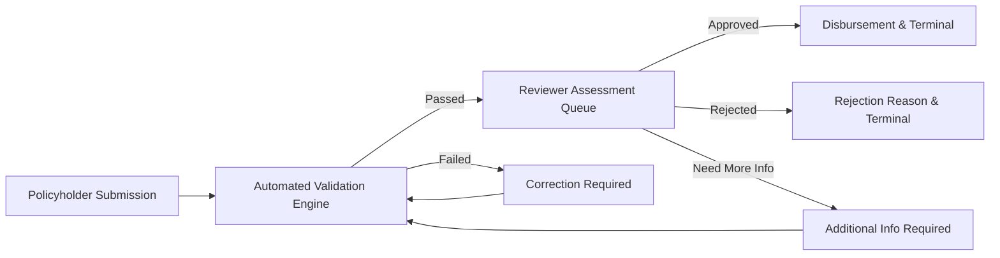

# 01. Problem Definition & Project Scope

## 1. Executive Summary & Problem Context
Health insurance claim settlement has historically been plagued by manual paperwork, opaque reviewer decisions, protracted turnaround times (typically 14–30 days), and vulnerability to duplicate or unauthorized submissions. Policyholders experience frustration due to lack of visibility into claim status, while insurance review officers and healthcare administrators struggle with disjointed audit trails and error-prone document validation.

**HealthSure** resolves these operational bottlenecks by providing an enterprise-grade, containerized health insurance claim workflow. The system coordinates every stage of the claim lifecycle—from policyholder submission and automated policy validation to reviewer adjudication and administrative oversight—backed by an immutable audit trail and containerized continuous delivery pipeline.

## 2. Project Scope

### In Scope
1. **Multi-Role User Portals:** Specialized dashboards and access-controlled views for Policyholders, Claims Reviewers, and System Administrators.
2. **Policy Lifecycle Management:** Coverage calculation, validity period enforcement, and active status checks.
3. **Automated Business Rule Engine:**
   - Active policy check and date range verification.
   - Available coverage balance check against claim amount.
   - Temporal duplicate submission detection (30-day window).
   - Safe document attachment verification.
4. **Finite State Machine:** Strict backend transitions:
   `DRAFT` -> `SUBMITTED` -> `UNDER_REVIEW` / `VALIDATION_FAILED` -> `APPROVED` / `REJECTED` / `ADDITIONAL_INFO_REQUIRED`.
5. **Immutable Audit Trail:** Trusted system events recording state changes, reviewer decisions, and file uploads.
6. **Containerization & CI/CD:** Multi-stage Docker packaging, Docker Compose orchestration with MySQL 8, 14-stage Jenkins pipeline, and Ansible server provisioning.
7. **Automated Quality Assurance:** JUnit 5 unit tests, Mockito service tests, and 5-journey Selenium browser tests.

### Out of Scope (Academic Boundaries)
- Direct real-time NEFT/RTGS banking gateway integrations.
- Production HIPAA/GDPR legal compliance audit certifications.
- Paid commercial OCR/AI document fraud recognition APIs.
