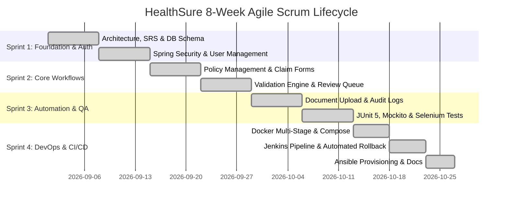

# 06. Product Backlog & 15-Task Scrum Plan

## 1. Scrum Sprint Cadence (4 Two-Week Sprints)

## 2. Product Backlog (Prioritized Epics & Tasks)
| Item | Epic | Story / Feature | Story Points | Sprint | Priority |
|---|---|---|:---:|:---:|:---:|
| **PBI-01** | Security | User Registration & Role-based authentication | 5 | Sprint 1 | High |
| **PBI-02** | Security | Single-session concurrency and CSRF hardening | 3 | Sprint 1 | High |
| **PBI-03** | Core | Insurance Policy Entity & available balance logic | 5 | Sprint 2 | High |
| **PBI-04** | Core | Claim Submission & Reference Code Generation | 8 | Sprint 2 | High |
| **PBI-05** | Workflow | Automated Claim Validation & Duplicate Detection | 8 | Sprint 2 | Critical |
| **PBI-06** | Workflow | Reviewer Adjudication & State Machine Transitions | 8 | Sprint 2 | Critical |
| **PBI-07** | Storage | Document Upload Service & Safe File Sanitization | 5 | Sprint 3 | High |
| **PBI-08** | Audit | Immutable Audit Event Trail & Timeline UI | 5 | Sprint 3 | Medium |
| **PBI-09** | Testing | JUnit 5 Service & Validation Test Suite | 5 | Sprint 3 | Critical |
| **PBI-10** | Testing | Selenium WebDriver 5-Journey E2E Test Suite | 8 | Sprint 3 | High |
| **PBI-11** | DevOps | Multi-stage Dockerfile with non-root security | 5 | Sprint 4 | Critical |
| **PBI-12** | DevOps | Docker Compose MySQL 8 persistent stack | 5 | Sprint 4 | Critical |
| **PBI-13** | DevOps | 14-Stage Declarative Jenkins Pipeline | 8 | Sprint 4 | Critical |
| **PBI-14** | DevOps | Ansible Server Provisioning & Config Management | 5 | Sprint 4 | High |
| **PBI-15** | DevOps | Actuator Health Probes & Automated Rollback | 5 | Sprint 4 | Critical |
