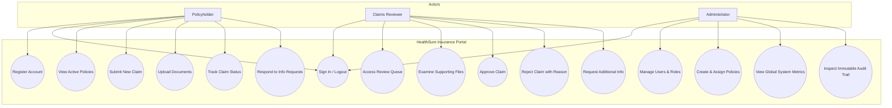

# 08. Use-Case Diagram

The following Mermaid diagram models the core use-case interactions for Policyholders, Claims Reviewers, and Administrators within the HealthSure platform:

### Actor Use-Case Matrix
- **Policyholder:** Manages self-registration, claim draft submission, file attachment, and lifecycle monitoring.
- **Claims Reviewer:** Evaluates claims in `UNDER_REVIEW`, inspects documents, requests additional diagnostic information, or approves/rejects claims with audited notes.
- **Administrator:** Manages system users, allocates insurance policies, reviews global claim counts and sums, and inspects the audit trail.
