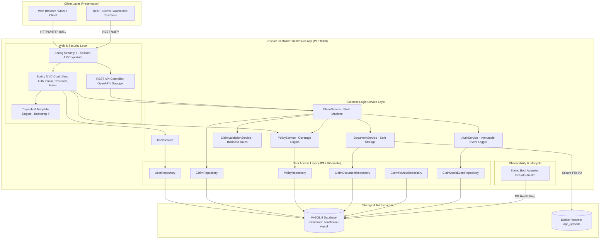

# 09. System Architecture Diagram

HealthSure follows a production-grade, maintainable layered enterprise architecture.

## Layer Responsibilities
1. **Security & Web Layer:** Intercepts requests, validates CSRF tokens, authorizes URLs against user roles, and renders responsive Thymeleaf HTML or JSON DTO responses.
2. **Service Layer:** Houses the claim lifecycle finite state machine, duplicate detection algorithms, monetary balance calculations, and audit logging.
3. **Repository Layer:** Spring Data JPA interfaces backed by Hibernate ORM with optimized queries.
4. **Data & Storage Layer:** MySQL 8 storing normalized relational data, with persistent volume mounts for file uploads.
