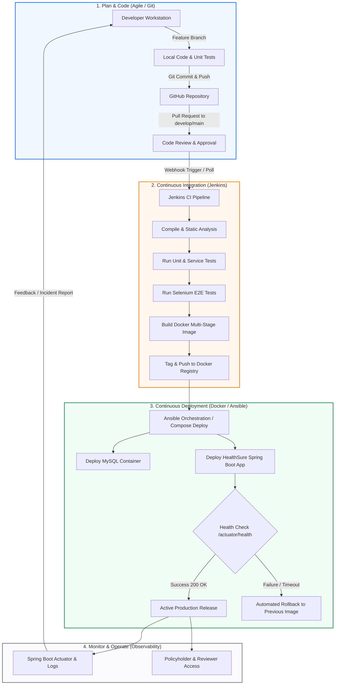

# DevOps Lifecycle Diagram & Process Overview

This document visualizes the complete DevOps lifecycle for **HealthSure – Dockerized Health Insurance Claim Workflow**, showing how source code transitions from development, testing, and continuous integration through to automated deployment and monitoring.

## Lifecycle Phases Description

1. **Plan & Track:** Requirements and user stories are tracked across 15 MVP tasks using Agile/Scrum.
2. **Develop:** Java 21 / Spring Boot 3 with Thymeleaf frontend, developed using feature branches (`feature/*`).
3. **Commit & Push:** Enforced commit conventions (e.g., `feat:`, `fix:`, `test:`).
4. **Build & Test (CI):** Jenkins declarative pipeline executes compile, unit tests (JUnit 5 + Mockito), and end-to-end Selenium WebDriver suites.
5. **Containerize:** Docker multi-stage build creates minimal, secure, non-root runtime image tagged with build number and `latest`.
6. **Deploy (CD):** Ansible playbook or Docker Compose deploys containers into an isolated bridge network with health verification.
7. **Rollback:** Automated script verifies container health via `/actuator/health`; on failure, reverts to previous stable image.
8. **Operate & Monitor:** Observability enabled via Actuator endpoints (`/actuator/health`, `/actuator/info`) and structured application logging.
