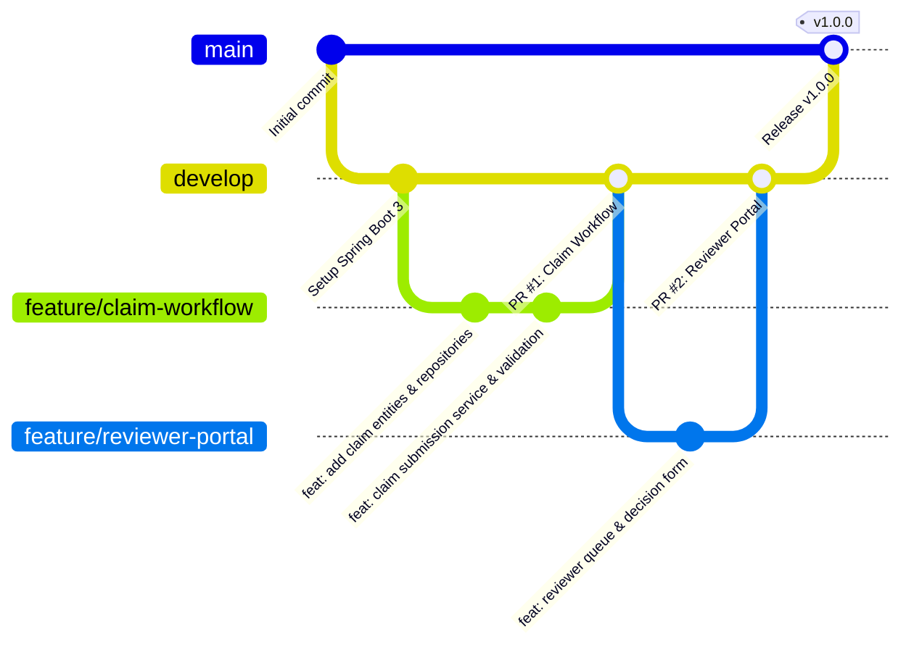

# Git Branching Strategy and Collaboration Guide

This document defines the branching strategy, commit conventions, pull request guidelines, and workflow for the **HealthSure** project.

## 1. Branching Strategy (Git Flow / Feature Branching)

We follow a structured Feature Branching workflow suitable for team collaboration and CI/CD automation:



### Primary Branches
- **`main`**: Production-ready branch. Only release tags and vetted merges from `develop` enter here.
- **`develop`**: Integration branch. All feature branches are merged here after passing automated checks.

### Supporting Branches
- **`feature/<feature-name>`**: Dedicated branch for implementing a single feature (e.g., `feature/claim-submission`, `feature/document-upload`).
- **`bugfix/<issue-id>`**: Bug fixes targeted at `develop`.
- **`hotfix/<issue-id>`**: Critical production fixes branching directly off `main` and merging to both `main` and `develop`.

---

## 2. Commit Message Conventions (Conventional Commits)

Format: `<type>(<scope>): <short description>`

### Allowed Types:
- `feat`: A new feature (e.g., `feat(claim): add duplicate submission validation rule`)
- `fix`: A bug fix (e.g., `fix(auth): fix session logout redirect`)
- `test`: Adding or updating automated tests (e.g., `test(selenium): add reviewer approval journey`)
- `docs`: Documentation changes (e.g., `docs(api): document claim REST endpoints`)
- `ci`: CI/CD changes (e.g., `ci(jenkins): update pipeline for windows bat execution`)
- `refactor`: Code restructuring without behavioral changes (e.g., `refactor(service): streamline claim status transitions`)
- `chore`: Dependency updates, build configurations (e.g., `chore(pom): upgrade spring boot starter version`)

---

## 3. Pull Request Guidelines

1. **Title:** Must follow the commit format (e.g., `feat(claims): implement claim history audit trail`).
2. **Template:** Use `.github/PULL_REQUEST_TEMPLATE.md` to document:
   - Summary of changes
   - Associated issue / task number
   - Verification steps performed (unit tests, manual testing)
   - Evidence of passing tests
3. **Review Requirements:** At least one peer review and all CI automated checks passing before merging.
4. **Merge Method:** Squash and Merge or Rebase to maintain a clean linear history on `develop`.

---

## 4. Local Git Setup & GitHub Push Commands

To initialize and push the repository:

```bash
# 1. Initialize git
git init -b main

# 2. Stage all project files
git add .

# 3. Create initial commit
git commit -m "feat: initial commit with complete HealthSure application, tests, docker, and ci/cd"

# 4. Create and checkout develop branch
git checkout -b develop

# 5. Link to your remote GitHub repository (replace with your repo URL)
git remote add origin https://github.com/your-username/healthsure-devops.git

# 6. Push branches to GitHub
git push -u origin main
git push -u origin develop
```
