# Jenkins CI/CD Setup and Pipeline Guide

This guide details the continuous integration and delivery architecture, configuration steps, and execution flow of the **HealthSure Declarative Jenkins Pipeline**.

---

## 1. Pipeline Overview

The pipeline defined in `Jenkinsfile` executes a 14-stage automated lifecycle:

```mermaid
flowchart LR
    S1[1. Checkout] --> S2[2. Env Verification]
    S2 --> S3[3. Compile]
    S3 --> S4[4. Unit Tests]
    S4 --> S5[5. Integration Tests]
    S5 --> S6[6. Package JAR]
    S6 --> S7[7. Static Analysis]
    S7 --> S8[8. Selenium Tests]
    S8 --> S9[9. Docker Build]
    S9 --> S10[10. Image Tagging]
    S10 --> S11[11. Registry Publish]
    S11 --> S12[12. Deploy Staging]
    S12 --> S13[13. Health Check & Rollback]
    S13 --> S14[14. Cleanup]

    style S1 fill:#e2e8f0,stroke:#64748b
    style S4 fill:#dbeafe,stroke:#2563eb
    style S8 fill:#fef3c7,stroke:#d97706
    style S9 fill:#ede9fe,stroke:#7c3aed
    style S13 fill:#dcfce7,stroke:#16a34a
```

---

## 2. Prerequisites & Jenkins Plugins

Ensure the following tools and plugins are available in Jenkins:

### Installed Tools
- **Java Development Kit (JDK 21 or higher)**
- **Apache Maven 3.9+**
- **Docker Desktop / Docker CLI** (accessible from Jenkins agent)
- **Google Chrome** (for Selenium headless tests)

### Required Jenkins Plugins
- Pipeline (Declarative Pipeline)
- Git Plugin
- JUnit Plugin (for parsing test reports under `target/surefire-reports/*.xml`)
- Docker Pipeline Plugin (optional if using local docker CLI via `bat` / `sh`)
- Credentials Plugin

---

## 3. Configuring the Pipeline in Jenkins

1. Open Jenkins Web UI at `http://localhost:8080/`.
2. Click **New Item**, enter `healthsure-pipeline`, and select **Pipeline**. Click **OK**.
3. Under **General**, check **GitHub project** (if linking GitHub) or configure descriptions.
4. Under **Build Triggers**:
   - For automated push builds: check **GitHub hook trigger for GITScm polling** or **Poll SCM** (e.g. `H/5 * * * *`).
5. Under **Pipeline**:
   - **Definition:** Select *Pipeline script from SCM* (or *Pipeline script* if pointing directly to workspace).
   - If using local filesystem or SCM:
     - **SCM:** Git
     - **Repository URL:** `file:///C:/Users/arpit/Desktop/College/DevOps/healthsure` (or GitHub URL)
     - **Branch Specifier:** `*/main` or `*/develop`
     - **Script Path:** `Jenkinsfile`
6. Click **Save**.

---

## 4. Environment Variables & Credentials Setup

In Jenkins -> **Manage Jenkins** -> **Credentials**:
- `DOCKERHUB_CREDENTIALS`: Username and Password for Docker Hub push (optional for local deployment).
- `DOCKER_REGISTRY_URL`: Registry endpoint (defaults to `docker.io`).
- `DOCKER_IMAGE_NAME`: Repository name (e.g., `healthsure/claim-workflow`).

---

## 5. Pipeline Stages Breakdown

| Stage | Command / Action | Output Artifact / Gate |
|---|---|---|
| **1. Checkout** | Git scm checkout | Cloned workspace |
| **2. Env Check** | `java -version`, `mvn -version`, `docker --version` | Environment diagnostics logged |
| **3. Compile** | `mvn clean compile -DskipTests=true` | Compiled `.class` files in `target/classes` |
| **4. Unit Tests** | `mvn test -Dtest=*Test` | Surefire XML reports (`target/surefire-reports`) |
| **5. Integration Tests**| `mvn test -Dtest=*IT` | Database/Spring Boot integration results |
| **6. Package** | `mvn package -DskipTests=true` | Executable `target/healthsure-1.0.0.jar` |
| **7. Static Analysis**| Static verification of code & configs | Clean verification log |
| **8. Selenium Tests** | `mvn test -Pselenium -Dapp.url=http://localhost:8081` | 5 user journey verification reports |
| **9. Docker Build** | `docker build -t healthsure:build-${BUILD_NUMBER} .` | Local Docker image built |
| **10. Image Tag** | `docker tag healthsure:build-${BUILD_NUMBER} healthsure:latest` | Canonical `latest` tag |
| **11. Registry Publish** | `docker push` (if credentials configured) | Remote image pushed to Docker Hub |
| **12. Deploy Staging** | `docker compose up -d` | Containers running in background |
| **13. Health Check & Rollback** | Curl check on `http://localhost:8081/actuator/health` | If healthy: Success. If failed: rollback to previous image |
| **14. Cleanup** | Clean unused containers / temporary test artifacts | System resources reclaimed |

---

## 6. Verification and Troubleshooting

- **Test Report Archiving:** Even if unit tests fail, the `post { always { junit '**/target/surefire-reports/*.xml' } }` block ensures test failure metrics are saved and displayed on the Jenkins build page.
- **Cross-Platform Compatibility:** The pipeline uses `isUnix()` checks to switch automatically between Windows `bat` commands and Linux `sh` commands.
