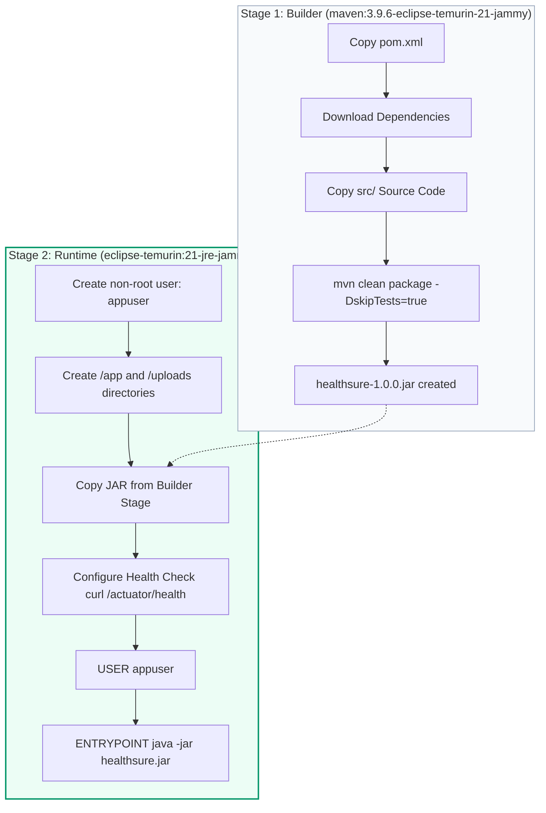

# Docker Container Lifecycle and Orchestration Guide

This guide details the containerization strategy, multi-stage build design, Docker Compose orchestration, and lifecycle maintenance commands for **HealthSure**.

---

## 1. Multi-Stage Dockerfile Architecture

The `Dockerfile` employs a 2-stage build to ensure minimal final image size, fast deployment, and hardened security:



### Security Highlights:
- **Non-Root Execution:** Container runs under unprivileged `appuser:appgroup` (UID 1001).
- **Distroless/Minimal Base:** Only the Temurin JRE runtime is included; Maven and compiler tools are discarded.
- **Excluded Secrets:** `.dockerignore` prevents copying `.env`, `git`, IDE settings, or local database files into the image.

---

## 2. Docker Compose Orchestration

The application stack is orchestrated via `docker-compose.yml`:

- **`healthsure-mysql`**:
  - Image: `mysql:8.0.36`
  - Port mapping: `3306:3306`
  - Health check: `mysqladmin ping -h localhost`
  - Persistent volume: `healthsure_mysql_data` mounted to `/var/lib/mysql`
- **`healthsure-app`**:
  - Build context: `.`
  - Port mapping: `8081:8080` (avoids conflict with native Jenkins on 8080)
  - Depends on: `healthsure-mysql` with `condition: service_healthy`
  - Persistent volume: `healthsure_app_uploads` mounted to `/app/uploads`
  - Health check: `curl -f http://localhost:8080/actuator/health`

---

## 3. Container Lifecycle Management Commands

### Start Services
```bash
# Build and start services in detached mode
docker compose up -d --build
```

### Check Container Status & Health
```bash
docker compose ps
```

### View Live Logs
```bash
# Follow logs for all containers
docker compose logs -f

# Follow logs specifically for the Spring Boot application
docker compose logs -f healthsure-app
```

### Restart a Service
```bash
docker compose restart healthsure-app
```

### Execute Database Backup
```bash
# Dump the MySQL database to a local SQL file
docker exec healthsure-mysql mysqldump -u root -prootpassword healthsure_db > backup_healthsure.sql
```

### Restore Database from Backup
```bash
docker exec -i healthsure-mysql mysql -u root -prootpassword healthsure_db < backup_healthsure.sql
```

### Clean Shutdown (Preserving Data)
```bash
docker compose down
```

### Deep Clean (Removing Volumes & Data)
```bash
# CAUTION: Removes persistent database data
docker compose down -v
```
