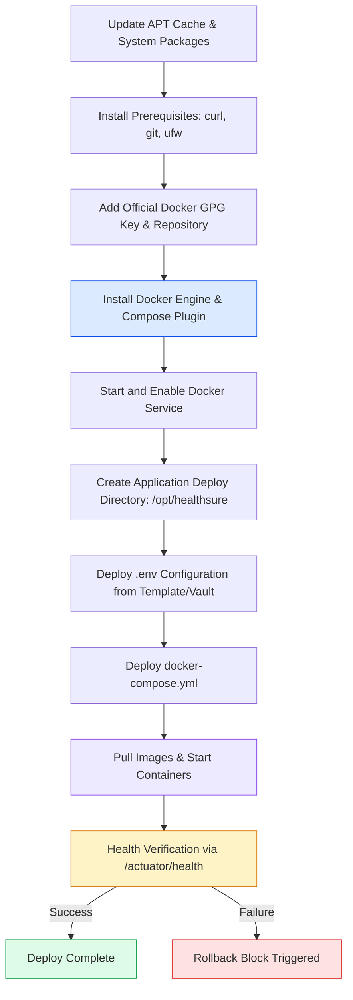

# Ansible Server Provisioning and Configuration Management Guide

This guide documents the automated configuration management, server provisioning, and deployment strategy for **HealthSure** on an Ubuntu/Debian target server using Ansible.

---

## 1. Directory Structure

```text
healthsure/ansible/
├── inventory.ini.example    # Sample host inventory with host variables
├── group_vars/
│   └── all.yml              # Centralized deployment variables and configuration
└── playbook.yml             # Main idempotent provisioning and deployment playbook
```

---

## 2. Playbook Architecture & Idempotence

The playbook (`playbook.yml`) executes the following sequential task blocks:



### Idempotency Guarantee:
Every task uses state declarations (`state: present`, `state: started`). Rerunning the playbook when the server is already in the desired state produces `0 changed` tasks and executes in seconds without restarting healthy services or dropping sessions.

---

## 3. Inventory Setup

Copy `inventory.ini.example` to `inventory.ini`:

```ini
[webservers]
prod-server ansible_host=192.168.1.50 ansible_user=ubuntu ansible_ssh_private_key_file=~/.ssh/id_rsa

[webservers:vars]
ansible_python_interpreter=/usr/bin/python3
```

---

## 4. Execution Commands

### Test Connectivity (Ping)
```bash
ansible -i inventory.ini webservers -m ping
```

### Dry Run (Check Mode)
Preview changes without modifying the target server:
```bash
ansible-playbook -i inventory.ini playbook.yml --check
```

### Execute Deployment
```bash
ansible-playbook -i inventory.ini playbook.yml
```

### Encrypting Production Secrets (Ansible Vault)
```bash
# Encrypt sensitive database password file
ansible-vault encrypt group_vars/vault.yml

# Run playbook with vault prompt
ansible-playbook -i inventory.ini playbook.yml --ask-vault-pass
```
