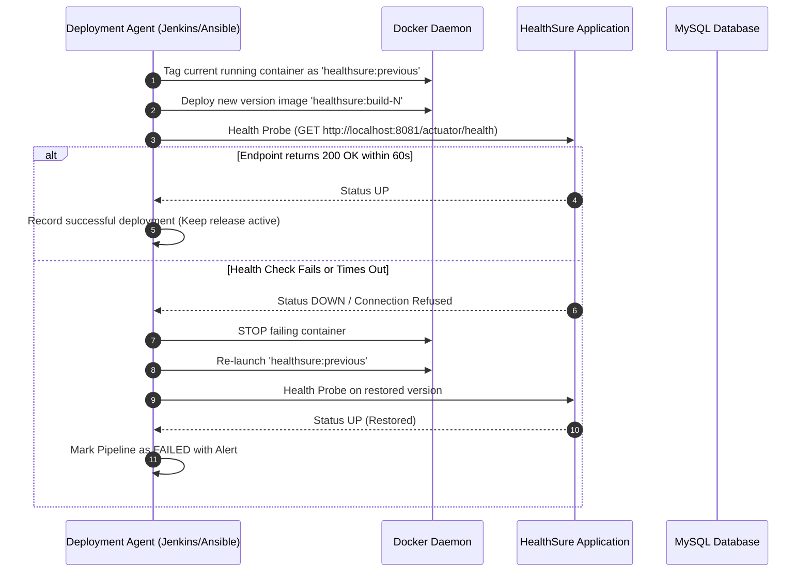

# Reliability, Health Checking, and Automated Rollback Guide

This document explains the reliability architecture, operational observability endpoints, health probing mechanisms, and automated rollback workflows implemented in **HealthSure**.

---

## 1. Observability & Health Endpoints

HealthSure integrates **Spring Boot Actuator** to provide operational visibility without exposing sensitive operational details:

- **Liveness & Readiness Probes (`/actuator/health`):**
  - Evaluates database connectivity (`SELECT 1`), disk space, and application responsiveness.
  - Returns `{"status":"UP"}` with HTTP 200 OK.
  - Used by Docker container healthcheck, Docker Compose service dependencies, Jenkins CD stage, and Ansible deployment verification.
- **Application Info (`/actuator/info`):**
  - Displays application name, version, and build timestamp.
- **Controlled Access:**
  - Administrative endpoints such as `/actuator/env` or heapdumps are strictly restricted or disabled to prevent credential leakage.

---

## 2. Automated Rollback Workflow

Both the **Jenkins CI/CD Pipeline** (`Jenkinsfile` Stage 13) and **Ansible Playbook** implement an active rollback mechanism:



---

## 3. Rollback Scripts & Manual Fallback

In the event of an automated deployment abort or container failure, manual rollback can be executed with a single command:

### Local Docker Compose Rollback:
```bash
# 1. Inspect recent images
docker images healthsure

# 2. Update .env or docker-compose.yml to reference the previous stable build tag
# e.g., APP_IMAGE=healthsure:previous
docker compose up -d --no-build

# 3. Verify healthcheck status
docker compose ps
curl -f http://localhost:8081/actuator/health
```

### Database Protection:
- Database schema changes are executed strictly via versioned Flyway migrations (`V1`, `V2`, etc.).
- Destructive operations (`DROP COLUMN`, `DROP TABLE`) are disallowed in deployment migrations, ensuring backward compatibility with the previous container version during rollback.
